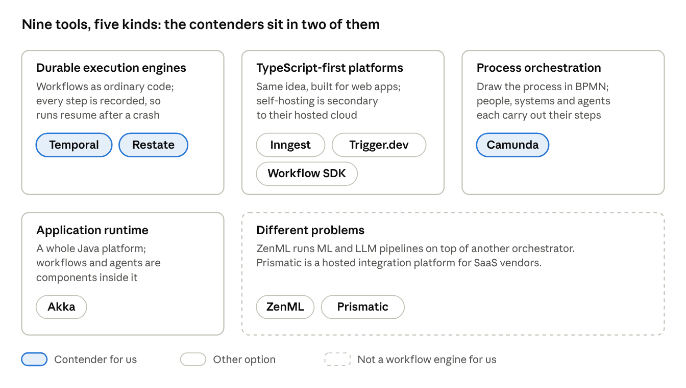
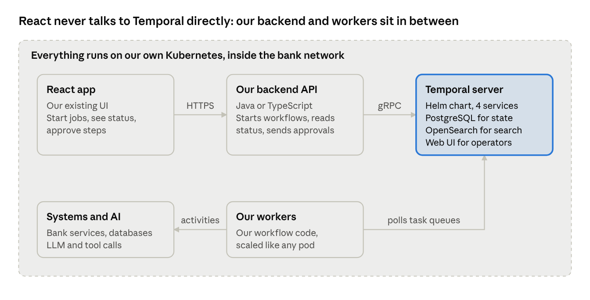

# Workflow Orchestration Options: On-Prem Comparison

October 15, 2026 · Connor McNeil

## Bottom line

**Temporal is the best fit for us.** It is free to run in production (MIT licence), has first-class Java and TypeScript SDKs, and covers backend, approval and AI-agent workflows in one engine.

**Camunda is the strongest alternative** if business-readable process diagrams and a vendor support contract matter more than licence cost. **Restate** is a lighter Temporal-style engine, but its licence and small vendor need review.

The others fall out: Inngest, Trigger.dev and Workflow SDK are TypeScript-first and cloud-first, with weaker self-hosted editions. Akka is a paid, Java-only runtime. ZenML and Prismatic solve different problems.

**The catch with Temporal:** self-hosting means we run and secure it ourselves. There is no published vendor support for self-hosted, and access control and audit logging are ours to build.

## What we need

Any option has to pass the first two filters before its features matter. Our backend language isn't chosen yet, so support for both Java and TypeScript counts.

| Requirement | What it means in practice |
| --- | --- |
| Fully on-prem | Self-hosted on our own Kubernetes; no vendor-hosted control plane; sensitive data never leaves the bank; works with restricted outbound internet |
| Production-grade self-hosting | The self-hosted edition is a real product with a licence we can use in production, not a dev-only mode |
| Three workload types | Backend service workflows (long-running jobs across internal systems), business processes with human approvals, and AI agent workflows (LLM and tool calls, human-in-the-loop) |
| Fits our React app | Workflows can be started from our existing React front end, and their status and approval steps shown there |
| Bank-friendly | Clear licence, security controls (auth, RBAC, audit), a stable vendor, ideally a support contract |

## Five kinds of tool

The nine tools are not all the same kind of product, which is why their comparison pages talk past each other.

Temporal and Restate solve the same problem the same way; Camunda solves it with diagrams instead of code. The TypeScript-first platforms target web teams on the vendor's cloud.

## Side-by-side comparison

Four tools can run production workloads on our own Kubernetes and cover all three workload types: Temporal, Camunda, Restate and Akka. Only Temporal has a permissive open-source licence; Camunda and Akka need paid licences, and Restate's BSL needs legal review.

| Tool | Runs on our Kubernetes? | Production licence | Java / TypeScript | Approvals and AI agents | React integration | Vendor support on-prem | Verdict |
| --- | --- | --- | --- | --- | --- | --- | --- |
| [Temporal](https://docs.temporal.io/evaluate/development-production-features/cloud-vs-self-hosted-features) | Yes. Official Helm chart (1.0, Apr 2026); we run the database and OpenSearch | MIT, free | Both first-class | Approvals in code (signals, timers); agent integrations GA in Python, preview in Java and TS | Through our backend; no browser client | None published for self-hosted | **Recommended** |
| [Camunda](https://docs.camunda.io/docs/self-managed/deployment/helm/) | Yes. Helm, OpenShift supported, air-gapped install documented | Paid Enterprise licence required | Java first; TypeScript supported | Built-in user tasks, forms and task inbox; AI Agent connector works with on-prem LLMs | REST API for processes and tasks | Yes, 24x7 with SLA | Alternative |
| [Restate](https://docs.restate.dev/server/deploy/kubernetes) | Yes. Operator and Helm; single binary, needs S3-compatible storage | BSL 1.1; internal production use free | Both official | Approvals via durable promises; agent integrations in TS and Python | HTTP ingress; we add the auth gateway | None published | Alternative |
| [Akka](https://doc.akka.io/operations/configuring.html) | Yes, from raw manifests (no Helm chart); Postgres | BSL 1.1; paid for a company our size; licence key | Java only | Workflow and Agent components; richest built-in agent features | Our own HTTP endpoints | Yes, commercial subscription | Weaker fit |
| [Inngest](https://www.inngest.com/docs/self-hosting) | Yes. Helm chart 0.3; Redis and Postgres | SSPL (Apache 2.0 after 3 years); legal review | TS first-class; Java early (Kotlin SDK 0.2) | Wait-for-event; AgentKit (TS) | React realtime hook (verify self-hosted) | None published | Weaker fit |
| [Trigger.dev](https://trigger.dev/docs/self-hosting/overview) | Yes, but heavy (Postgres, Redis, ClickHouse, S3, registry); self-hosted loses checkpoints, SSO, RBAC | Apache 2.0, free | TypeScript only | Wait tokens, but a waiting run holds a pod when self-hosted | Best: official React hooks | None; Cloud only | Weaker fit |
| [Workflow SDK](https://workflow-sdk.dev/worlds/postgres) | Only via the Postgres reference backend: no auth, no encryption, no Helm | Apache 2.0, free | TypeScript only | Hooks; Vercel AI SDK agents | Through our TypeScript API routes | None | Weaker fit |
| [ZenML](https://docs.zenml.io/getting-started/deploying-zenml) | Server via Helm; RBAC, SSO, audit and API-started runs are paid | Apache 2.0 core; Enterprise tier is paid | Python only | Not built for approvals; ML pipelines | Its own dashboard | Enterprise plan only | Out of scope |
| [Prismatic](https://prismatic.io/docs/configure-prismatic/deployment-regions/) | No. Vendor-run SaaS; no on-prem option documented | Subscription | TypeScript (integrations) | No approval workflows | Built to embed in SaaS products | SaaS plans only | Out of scope |

## Tool by tool

Three tools are serious contenders for us; the other six fail on licence, self-hosting or category. The vendor comparison pages are marketing, so the points below were checked against each tool's docs, licence files and source code.

### Temporal

A durable-execution engine: we write workflows as ordinary code, and Temporal records every step so a run resumes exactly where it stopped after a crash. Built by the team behind Uber's Cadence; founded 2019.

**Pros**

- MIT licence, no licence key; core features are all available self-hosted.
- Official SDKs for Java, TypeScript, Python, Go, .NET, Ruby, PHP and Rust.
- One engine for all three workloads: timers that can wait months, approvals via signals and updates, and agent integrations (OpenAI Agents SDK is GA in Python).
- A full event history for every run, which doubles as an audit trail.
- Widely used in finance: JPMorgan Chase, ANZ and SoFi (mostly on Temporal Cloud).
- Well-funded vendor: a $550M Series E in September 2026.

**Cons**

- We operate it: four server services plus a database and OpenSearch. The shard count is fixed at install, and upgrades go one minor version at a time.
- Security is ours to build: the default authorizer allows every request until we plug one in (a JWT-based option ships with it), and there is no RBAC or audit log out of the box.
- No published support contract for self-hosted; the vendor steers production users to Cloud.
- Learning curve: workflow code must be deterministic, and changing running workflows needs versioning.
- No visual designer or approver inbox; approval screens would be built in our React app.
- Sends a daily version check to Temporal unless we turn it off.

**Fit for us:** best overall, provided we budget for platform operations and security hardening.

### Camunda

A process-orchestration platform: flows are drawn as BPMN diagrams and run on the Zeebe engine, while our code handles the individual steps. Founded 2008 in Berlin.

**Pros**

- Process diagrams the business can read, plus DMN decision tables.
- Built-in human tasks, forms, a task inbox (Tasklist), monitoring (Operate) and reporting (Optimize).
- Agent features since version 8.8 (Oct 2025): an AI Agent connector and MCP support, working with on-prem LLMs.
- Strong in banking: Goldman Sachs and Desjardins are customers, and Camunda claims 9 of the top 10 US banks.
- 24x7 enterprise support with an SLA; OpenShift and air-gapped installs are documented.
- Since 8.9 it can store data in databases banks already run (PostgreSQL, Oracle, SQL Server).

**Cons**

- Self-managed production use needs a paid Enterprise licence, and prices aren't published.
- Source-available, not open source.
- The architecture changed in each of 8.8, 8.9 and 8.10, and each version gets 18 months of support, so expect regular upgrade work.
- More components to run than Temporal.
- The team must learn BPMN, and logic is split between diagrams and code.

**Fit for us:** the best choice if approval-heavy business processes dominate and there is budget for the licence.

### Restate

A lightweight durable-execution engine: one Rust binary with built-in storage that calls our services over HTTP. Built by the creators of Apache Flink.

**Pros**

- Much simpler to run: a single binary with no external database (it needs S3-compatible storage for snapshots).
- Official SDKs for Java, TypeScript, Python, Go and Rust.
- Its HTTP interface makes it easy for our backend to start runs and resolve approvals.
- The Kubernetes operator drains old code versions automatically.
- AI integrations for the Vercel AI SDK, OpenAI Agents SDK and Pydantic AI. References include an unnamed Fortune-100 US bank and KPMG UK on-prem.

**Cons**

- BSL 1.1 licence: internal production use is free, but it isn't open source, so legal must sign off.
- No built-in authentication on its HTTP interface, admin API or UI; we would put a gateway in front.
- Small company ($27M raised), with frequent releases that include breaking changes.
- No published support for self-hosted.
- Its docs discourage handlers that run for weeks, so long approvals need careful design.
- Sends usage telemetry by default.

**Fit for us:** a credible runner-up on technology; vendor and licence risk keep it behind Temporal for now.

### Akka

A Java platform for stateful services built on the actor model; workflows and AI agents are components inside it. The company was called Lightbend until November 2024.

**Pros**

- The richest built-in agent features: memory, MCP, guardrails and multi-agent setups.
- Event-sourced storage gives a built-in audit trail.
- Only needs PostgreSQL.
- Commercial support available; Capital One and Manulife are listed as customers.

**Cons**

- BSL licence: companies with over $25M revenue need a paid licence and a licence key in production.
- Java only.
- We would build whole services inside Akka's model, not just workflows.
- No Helm chart, and self-managed mode loses automated failover and scaling.
- Unconfirmed whether the licence key works without internet access.

**Fit for us:** too much cost and lock-in for what we need.

### Inngest

Event-driven durable functions: an event triggers a function, and the Inngest server calls our app over HTTP for each step.

**Pros**

- Light to run: one Go binary plus Redis and PostgreSQL.
- No determinism rules, so it is easy for TypeScript developers.
- Built-in concurrency limits, throttling and rate limiting; waiting runs use no compute.
- AgentKit for TypeScript agents, and a React hook for live run updates.

**Cons**

- The server is licensed under SSPL, which many bank open-source policies ban.
- Java support is an early Kotlin SDK (version 0.2).
- No published support for self-hosted; SSO, RBAC and audit trails are Cloud Enterprise features.
- The Helm chart is still 0.x, and telemetry is on by default.
- No financial-services customers found.

**Fit for us:** good developer experience, but the licence and the Java gap rule it out.

### Trigger.dev

A TypeScript platform that runs each task in its own container and supports long waits.

**Pros**

- Apache 2.0 licence.
- The best React story: official hooks to start runs, watch them live and approve steps from the UI.
- Each run stays on the code version it started with.
- AI-first features such as durable chat agents and Vercel AI SDK support.

**Cons**

- TypeScript only.
- The self-hosted edition loses checkpoints, so a run waiting days for approval holds a pod the whole time. It also loses SSO and RBAC.
- Heavy infrastructure: PostgreSQL, Redis, ClickHouse, S3 storage and a container registry, with a 6 vCPU / 12 GB minimum.
- The vendor says self-hosting is at your own risk, with Discord-only support.

**Fit for us:** the weakest self-hosted edition of the serious options.

### Workflow SDK

Vercel's open-source TypeScript library, launched October 2025, that turns functions into durable workflows with `"use workflow"` directives.

**Pros**

- Apache 2.0, with no separate server to run.
- An excellent TypeScript and Vercel AI SDK experience.

**Cons**

- Built around Vercel's platform. The self-hosted PostgreSQL backend is a "reference" implementation with no authentication or encryption, not optimized for scale.
- TypeScript only (Python is in beta).
- No Kubernetes tooling or support, and how running workflows handle new versions self-hosted is undocumented.
- About a year old and already on version 5.

**Fit for us:** fine for a prototype, not for a bank's core platform.

### ZenML

A Python framework for ML and LLM pipelines that runs on top of another orchestrator such as Kubernetes or Airflow. It is not a workflow engine itself.

- **Pros:** Apache 2.0, a Helm chart, and useful later if we need model-training or evaluation pipelines.
- **Cons:** Python only and pre-1.0. No approvals or long-running processes. RBAC, SSO, audit logs and air-gapped installs are paid. Its agent product has already changed direction.
- **Fit for us:** a different category.

### Prismatic

An embedded integration platform for SaaS companies that build integrations into their own products.

- **Pros:** a low-code integration designer, and an MCP server that exposes flows to agents.
- **Cons:** Vendor-run SaaS; no on-prem or Kubernetes option is documented. Built for a different buyer, with no approval or long-running backend workflows.
- **Fit for us:** fails the on-prem requirement.

## Recommendation

Go with Temporal, self-hosted on our Kubernetes, and prove it with a short proof of concept before committing.

**Why Temporal wins for us**

1. It clears both hard filters at no licence cost: it runs fully on our cluster, needs no licence key, and nothing leaves the network once the version check is off.
2. It keeps the language decision open, with first-class Java and TypeScript SDKs.
3. One engine covers backend jobs, approvals and AI agents, so we learn and run one platform.
4. Camunda's biggest advantage, its built-in task inbox, matters less to us: we want approvals inside our own React app anyway.
5. It has the largest community of the code-first engines, which helps with hiring and troubleshooting.

**Pick Camunda instead if** the business wants to see and change process diagrams itself, most of the work is human approvals, or compliance requires a vendor SLA. Check first whether another team at the bank already holds a Camunda licence.

**Revisit Restate if** running Temporal's cluster proves too heavy and legal clears its BSL licence.

**Why the rest fall out:** Inngest (SSPL licence, early Java), Trigger.dev (TypeScript only, weak self-hosted edition), Workflow SDK (self-hosted backend not hardened), Akka (paid, Java-only runtime), ZenML and Prismatic (different categories).

**How it would fit our React app**

An approver clicks in our React app; our backend sends that decision to the waiting workflow as a signal, and the workflow carries on.

## Risks, open questions and next steps

The main risk is operational: self-hosted Temporal is free to license but not free to run, and its security controls are ours to build.

**Risks to plan for**

- **Ownership:** someone owns the cluster, its database, OpenSearch and one-version-at-a-time upgrades.
- **Security:** we set up mTLS, a real authorizer tied to bank SSO, Web UI login and audit logging; out of the box, every request is allowed.
- **Disaster recovery:** multi-cluster replication is experimental when self-hosted, so plan backups and a manual failover.
- **Support:** no published support contract for self-hosted; we rely on docs, the forum and partners unless sales offers one.

**Questions for vendors**

- Temporal: will you sell a support contract or SLA for a self-hosted deployment?
- Camunda: what does an Enterprise licence cost at our scale, and does the licence check or usage reporting need internet access?
- Restate: is paid support available for self-hosted?

**Next steps**

- [ ] Check whether any team at the bank already runs Temporal or Camunda.
- [ ] Run a two-week proof of concept on our Kubernetes with one real job from our app: start it from React, wait days for an approval, call an LLM, and kill a pod mid-run to watch it recover.
- [ ] Security review of the self-hosted setup: mTLS, authorizer, SSO for the Web UI, audit logging.
- [ ] Choose the language for our workflow workers: Java or TypeScript.
- [ ] Ask Temporal sales about self-hosted support.

## Sources

Vendor comparison pages (marketing): [Inngest vs Temporal](https://www.inngest.com/compare-to-temporal) · [Akka on Inngest vs Temporal](https://akka.io/blog/inngest-vs-temporal) · [ZenML on Inngest vs Temporal](https://www.zenml.io/blog/inngest-vs-temporal) · [Trigger.dev vs Temporal](https://trigger.dev/vs/temporal) · [Restate vs Temporal](https://restate.dev/vs/temporal) · [Workflow SDK vs Temporal](https://workflow-sdk.dev/docs/comparisons/workflow-sdk-vs-temporal)

- **Temporal:** [Cloud vs self-hosted features](https://docs.temporal.io/evaluate/development-production-features/cloud-vs-self-hosted-features) · [Production checklist](https://docs.temporal.io/self-hosted-guide/production-checklist) · [Security](https://docs.temporal.io/self-hosted-guide/security) · [Helm chart 1.0](https://temporal.io/blog/an-important-milestone-for-temporals-helm-charts) · [Persistence](https://docs.temporal.io/temporal-service/persistence) · [SDKs](https://docs.temporal.io/encyclopedia/temporal-sdks) · [OpenAI Agents SDK integration](https://docs.temporal.io/develop/python/integrations/openai-agents) · [Licence](https://github.com/temporalio/temporal/blob/main/LICENSE) · [Financial services](https://temporal.io/solutions/financial-services) · [Series E](https://thenextweb.com/news/temporal-550m-series-e-12-55bn-valuation-lightspeed)
- **Camunda:** [Helm deployment](https://docs.camunda.io/docs/self-managed/deployment/helm/) · [Air-gapped install](https://docs.camunda.io/docs/self-managed/deployment/helm/configure/registry-and-images/air-gapped-installation/) · [Licensing change](https://camunda.com/blog/2024/10/camunda-licensing-what-you-need-to-know/) · [Pricing](https://camunda.com/pricing/) · [Licences](https://docs.camunda.io/docs/reference/licenses/) · [AI Agent connector](https://docs.camunda.io/docs/components/connectors/out-of-the-box-connectors/agentic-ai-aiagent/) · [Local LLMs](https://camunda.com/blog/2026/01/use-local-llms-with-c8-run/) · [Release overview](https://docs.camunda.io/docs/reference/announcements-release-notes/overview/) · [Goldman Sachs](https://camunda.com/about/customers/goldman-sachs/) · [Desjardins](https://page.camunda.com/talking-process-orchestration-with-desjardins-marc-steben) · [Aug 2026 press release (bank claim)](https://camunda.com/press-releases/camunda-closing-in-on-200m-in-arr-doubling-revenue-in-record-time/)
- **Restate:** [Licence](https://github.com/restatedev/restate/blob/main/LICENSE) · [Kubernetes](https://docs.restate.dev/server/deploy/kubernetes) · [Security](https://docs.restate.dev/server/security) · [Versioning](https://docs.restate.dev/services/versioning) · [Human-in-the-loop](https://docs.restate.dev/ai/patterns/human-in-the-loop) · [Hosting options](https://docs.restate.dev/hosting/overview) · [Use cases](https://www.restate.dev/use-cases) · [Series A](https://tech.eu/2026/09/30/berlin-based-restate-raises-20m/)
- **Akka:** [Self-managed deployment](https://doc.akka.io/operations/configuring.html) · [Licence keys](https://akka.io/blog/akka-license-keys-and-no-spam-promise) · [BSL FAQ](https://akka.io/bsl-license-faq) · [Agents](https://doc.akka.io/akka-agents.html) · [Workflows](https://doc.akka.io/java/workflows.html) · [Lightbend is now Akka](https://akka.io/blog/lightbend-is-now-akka)
- **Inngest:** [Self-hosting](https://www.inngest.com/docs/self-hosting) · [Licence](https://github.com/inngest/inngest/blob/main/LICENSE.md) · [Helm chart](https://github.com/inngest/inngest-helm) · [Kotlin SDK](https://github.com/inngest/inngest-kt) · [Pricing](https://www.inngest.com/pricing) · [Versioning](https://www.inngest.com/docs/learn/versioning)
- **Trigger.dev:** [Self-hosting overview](https://trigger.dev/docs/self-hosting/overview) · [Kubernetes](https://trigger.dev/docs/self-hosting/kubernetes) · [Enterprise](https://trigger.dev/enterprise) · [Licence](https://github.com/triggerdotdev/trigger.dev/blob/main/LICENSE) · [Wait tokens](https://trigger.dev/docs/wait-for-token) · [React hooks](https://trigger.dev/docs/realtime/react-hooks/overview)
- **Workflow SDK:** [Postgres World](https://workflow-sdk.dev/worlds/postgres) · [Deploying](https://workflow-sdk.dev/docs/deploying) · [Hooks](https://workflow-sdk.dev/docs/foundations/hooks) · [Licence](https://github.com/vercel/workflow/blob/main/LICENSE.md) · [Launch post](https://vercel.com/blog/introducing-workflow)
- **ZenML:** [Orchestrators](https://docs.zenml.io/stacks/stack-components/orchestrators) · [Deploying](https://docs.zenml.io/getting-started/deploying-zenml) · [Open source vs Pro](https://zenml.io/open-source-vs-pro) · [Pricing](https://www.zenml.io/pricing)
- **Prismatic:** [Deployment regions](https://prismatic.io/docs/configure-prismatic/deployment-regions/) · [On-prem agent](https://prismatic.io/docs/integrations/connections/on-prem-agent/) · [Pricing](https://prismatic.io/pricing)
