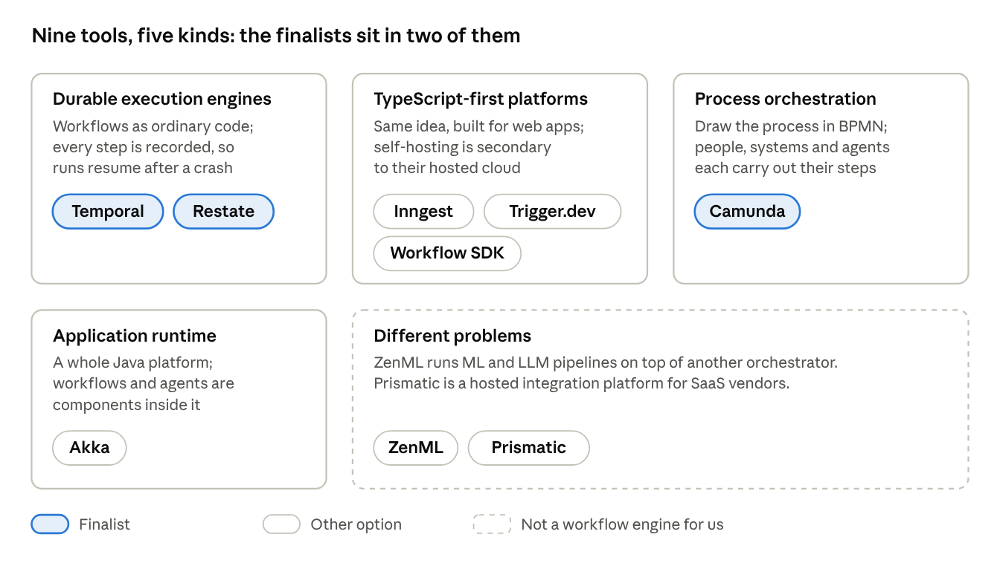
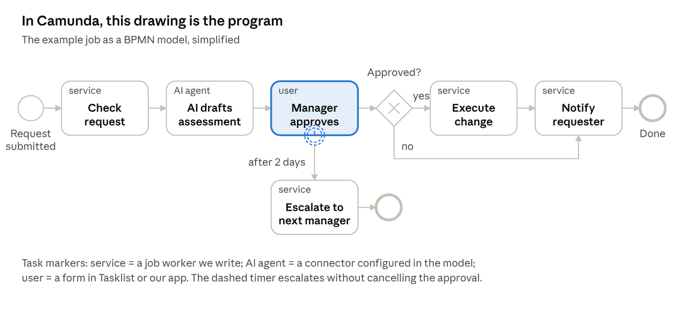
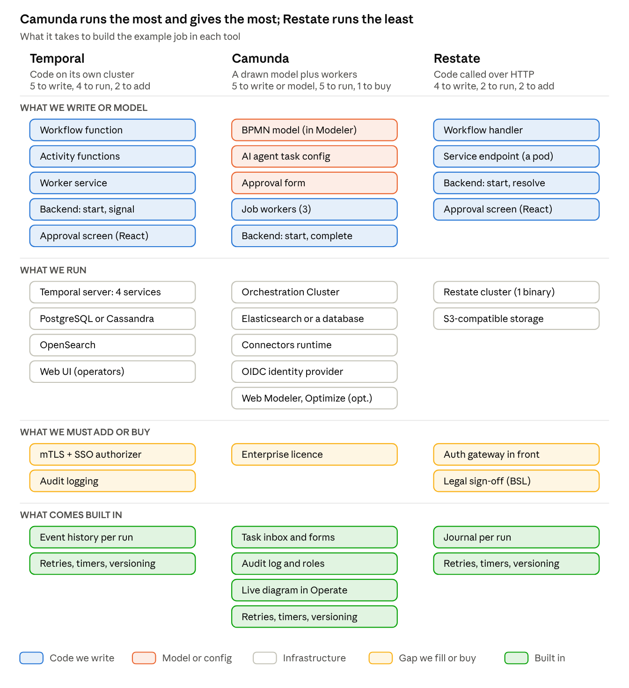

# Workflow Orchestration: Temporal vs Camunda vs Restate

October 15, 2026 · Connor McNeil

## Bottom line

**Only three of the nine tools fit our constraints: Temporal, Camunda and Restate.** All three run production workflows on our own Kubernetes and cover backend jobs, approvals and AI agents.

**They build workflows in very different ways.** In Camunda you draw the process as a BPMN diagram and write small workers for the steps. In Temporal and Restate the workflow is ordinary code: Temporal runs it on its own cluster, while Restate calls our services over HTTP from a single binary.

**Building the same job three ways makes the trade-off clear.** Camunda gives the most out of the box (task inbox, forms, audit, a diagram the business can read) but has the most to run and needs a paid licence. Restate has the least to run but leaves security to us and is the youngest vendor. Temporal sits in between and is free.

**Recommendation: Temporal**, with Camunda as the pick if business-owned process diagrams or a vendor SLA matter more than cost.

## What we need

Any option has to pass the first two filters before its features matter. Our backend language isn't chosen yet, so support for both Java and TypeScript counts.

| Requirement | What it means in practice |
| --- | --- |
| Fully on-prem | Self-hosted on our own Kubernetes; no vendor-hosted control plane; sensitive data never leaves the bank; works with restricted outbound internet |
| Production-grade self-hosting | The self-hosted edition is a real product with a licence we can use in production, not a dev-only mode |
| Three workload types | Backend service workflows (long-running jobs across internal systems), business processes with human approvals, and AI agent workflows (LLM and tool calls, human-in-the-loop) |
| Fits our React app | Workflows can be started from our existing React front end, and their status and approval steps shown there |
| Bank-friendly | Clear licence, security controls (auth, RBAC, audit), a stable vendor, ideally a support contract |

## Five kinds of tool

The nine tools are not all the same kind of product, which is why their comparison pages talk past each other.



Temporal and Restate solve the same problem the same way; Camunda solves it with diagrams instead of code. The TypeScript-first platforms target web teams on the vendor's cloud.

## Side-by-side comparison

Four tools can run production workloads on our own Kubernetes and cover all three workload types: Temporal, Camunda, Restate and Akka. Akka drops out on cost and lock-in (a paid, Java-only runtime), leaving three finalists.

| Tool | Runs on our Kubernetes? | Production licence | Java / TypeScript | Approvals and AI agents | React integration | Vendor support on-prem | Verdict |
| --- | --- | --- | --- | --- | --- | --- | --- |
| [Temporal](https://docs.temporal.io/evaluate/development-production-features/cloud-vs-self-hosted-features) | Yes. Official Helm chart (1.0, Apr 2026); we run the database and OpenSearch | MIT, free | Both first-class | Approvals in code (signals, timers); agent integrations GA in Python, preview in Java and TS | Through our backend; no browser client | None published for self-hosted | **Finalist** |
| [Camunda](https://docs.camunda.io/docs/self-managed/deployment/helm/) | Yes. Helm, OpenShift supported, air-gapped install documented | Paid Enterprise licence required | Java first; TypeScript supported | Built-in user tasks, forms and task inbox; AI Agent connector works with on-prem LLMs | REST API for processes and tasks | Yes, 24x7 with SLA | **Finalist** |
| [Restate](https://docs.restate.dev/server/deploy/kubernetes) | Yes. Operator and Helm; single binary, needs S3-compatible storage | BSL 1.1; internal production use free | Both official | Approvals via durable promises; agent integrations in TS and Python | HTTP ingress; we add the auth gateway | None published | **Finalist** |
| [Akka](https://doc.akka.io/operations/configuring.html) | Yes, from raw manifests (no Helm chart); Postgres | BSL 1.1; paid for a company our size; licence key | Java only | Workflow and Agent components; richest built-in agent features | Our own HTTP endpoints | Yes, commercial subscription | Weaker fit |
| [Inngest](https://www.inngest.com/docs/self-hosting) | Yes. Helm chart 0.3; Redis and Postgres | SSPL (Apache 2.0 after 3 years); legal review | TS first-class; Java early (Kotlin SDK 0.2) | Wait-for-event; AgentKit (TS) | React realtime hook (verify self-hosted) | None published | Weaker fit |
| [Trigger.dev](https://trigger.dev/docs/self-hosting/overview) | Yes, but heavy (Postgres, Redis, ClickHouse, S3, registry); self-hosted loses checkpoints, SSO, RBAC | Apache 2.0, free | TypeScript only | Wait tokens, but a waiting run holds a pod when self-hosted | Best: official React hooks | None; Cloud only | Weaker fit |
| [Workflow SDK](https://workflow-sdk.dev/worlds/postgres) | Only via the Postgres reference backend: no auth, no encryption, no Helm | Apache 2.0, free | TypeScript only | Hooks; Vercel AI SDK agents | Through our TypeScript API routes | None | Weaker fit |
| [ZenML](https://docs.zenml.io/getting-started/deploying-zenml) | Server via Helm; RBAC, SSO, audit and API-started runs are paid | Apache 2.0 core; Enterprise tier is paid | Python only | Not built for approvals; ML pipelines | Its own dashboard | Enterprise plan only | Out of scope |
| [Prismatic](https://prismatic.io/docs/configure-prismatic/deployment-regions/) | No. Vendor-run SaaS; no on-prem option documented | Subscription | TypeScript (integrations) | No approval workflows | Built to embed in SaaS products | SaaS plans only | Out of scope |

**Three make the cut: Temporal, Camunda and Restate.** The rest of this doc compares only those three; the other six are covered in [the first version](01-on-prem-comparison.md).

## The three finalists side by side

The finalists solve the same problem with three different building blocks: a coded workflow on its own cluster (Temporal), a drawn process model (Camunda), and coded handlers called over HTTP (Restate).

| | Temporal | Camunda | Restate |
| --- | --- | --- | --- |
| How you define a workflow | Code: a workflow function plus activity functions | A BPMN diagram drawn in the Modeler, plus job workers in code | Code: handlers in an HTTP service, each step wrapped in `ctx.run` |
| Who can read it | Developers | Developers and business analysts, from the same diagram | Developers |
| How it runs our code | Our workers poll Temporal's task queues | Our job workers pick up the jobs for each service task | Restate pushes calls to our service over HTTP |
| What we run | 4 server services, a database (PostgreSQL or Cassandra), OpenSearch | Orchestration Cluster (Zeebe, Operate, Tasklist), Elasticsearch or a database, Connectors runtime, an OIDC identity provider | One binary (3 nodes for high availability) plus S3-compatible storage |
| Human approvals | A signal into the waiting workflow; we build the screen | User tasks with forms and a task inbox (Tasklist) built in | A durable promise resolved over HTTP; we build the screen |
| AI agents | Activities call the LLM; OpenAI Agents SDK GA in Python, preview in Java and TS | AI Agent connector configured in the model; works with on-prem LLMs | Steps call the LLM; Vercel AI SDK and OpenAI Agents SDK integrations |
| Changing running workflows | Worker Versioning or patches in code; runs stay on the code they started with | Deploy a new model version; migrate running instances if needed | Runs stay pinned to their deployment; old versions stay up until drained |
| Seeing where a run is | Web UI: the event history of each run | Operate: the run highlighted on its diagram | Restate UI: the journal of each run |
| Security out of the box | Allows every request until we add mTLS and an authorizer | Built-in identity, authorizations and an audit log | No auth on ingress or admin; we put a gateway in front |
| Licence | MIT, free | Paid Enterprise licence for production | BSL 1.1, internal production use free |
| Vendor support on-prem | None published | 24x7 with SLA | None published |
| Banking references | JPMorgan Chase, ANZ, SoFi (mostly on Temporal Cloud) | Goldman Sachs, Desjardins; claims 9 of the top 10 US banks | An unnamed Fortune-100 US bank; KPMG UK on-prem |

## How each one works

Each finalist puts the workflow in a different place: Temporal in a code function, Camunda in a diagram, Restate in an HTTP service. That choice drives who can read it, what we run and what we build ourselves.

### Temporal: the workflow is a function

**How you build with it**

1. Write a workflow function in Java or TypeScript that lists the steps in order.
2. Put every side effect (API calls, database writes, LLM calls) in activity functions; Temporal retries them.
3. Run a worker service on Kubernetes that hosts both and polls a task queue.
4. From our backend, start runs, query their status and send approvals as signals with the Temporal client.

The rule to learn: workflow code must be deterministic (no clocks, randomness or I/O except through Temporal's APIs), because Temporal replays it from the event history to resume after a failure.

**Pros**

- MIT licence, no licence key; core features are all available self-hosted.
- First-class SDKs for Java, TypeScript, Python, Go, .NET and more.
- Timers that can wait months, approvals via signals, and agent integrations (OpenAI Agents SDK is GA in Python).
- A full event history for every run, which doubles as an audit trail.
- Widely used in finance, and a well-funded vendor ($550M Series E, September 2026).

**Cons**

- We operate it: four server services plus a database and OpenSearch. The shard count is fixed at install, and upgrades go one minor version at a time.
- Security is ours to build: every request is allowed until we plug in an authorizer, and there is no RBAC or audit log out of the box.
- No published support contract for self-hosted.
- No visual designer or approver inbox; approval screens live in our React app.

**Fit for us:** best overall, provided we budget for operations and security hardening.

### Camunda: the workflow is a diagram

**How you build with it**

1. Draw the process in BPMN in the Modeler (a desktop app, or Web Modeler in the browser): tasks, decisions, timers and user tasks.
2. Attach a form to each user task, and DMN decision tables where business rules apply.
3. Write a job worker in Java or TypeScript for each service task; connectors (REST, AI Agent) cover common steps without code.
4. Deploy the model to the cluster, then start instances and complete tasks through the REST API, Tasklist or our React app.

What changes: logic is split between the diagram and the workers, and the diagram is what the business reads and signs off. Operate shows every running instance on that same diagram.

**Pros**

- Process diagrams the business can read, plus DMN decision tables.
- Built-in user tasks, forms, task inbox (Tasklist), monitoring (Operate) and reporting (Optimize).
- AI Agent connector since 8.8 (October 2025), working with on-prem LLMs.
- Strong in banking, with 24x7 enterprise support and an SLA.
- Since 8.9 it can store data in databases banks already run (PostgreSQL, Oracle, SQL Server).

**Cons**

- Self-managed production use needs a paid Enterprise licence; prices aren't published.
- The most components to run of the three.
- The architecture changed in each of 8.8, 8.9 and 8.10, and each version gets 18 months of support, so expect regular upgrades.
- The team must learn BPMN, and logic is split between diagrams and code.

**Fit for us:** the best choice if approval-heavy business processes dominate and there is budget for the licence.

### Restate: the workflow is an HTTP service

**How you build with it**

1. Write a workflow handler in Java or TypeScript with the Restate SDK.
2. Wrap every side effect in `ctx.run` so its result is journaled and never repeated.
3. Deploy the service as an ordinary HTTP endpoint and register it with the Restate server.
4. Start runs and resolve approvals by calling Restate's HTTP ingress from our backend.

What changes: the same discipline as Temporal (anything non-deterministic goes through the SDK), but there are no workers polling. Restate drives our service by calling it.

**Pros**

- By far the least to run: one binary with built-in storage, plus S3-compatible storage for snapshots.
- Official Java, TypeScript, Python, Go and Rust SDKs.
- Plain HTTP makes it easy to start runs and resolve approvals from our backend.
- The Kubernetes operator drains old code versions automatically.
- References include an unnamed Fortune-100 US bank and KPMG UK on-prem.

**Cons**

- BSL 1.1 licence: internal use is free, but it isn't open source, so legal must sign off.
- No built-in authentication on its HTTP interface, admin API or UI.
- Small company ($27M raised), with frequent releases that include breaking changes.
- No published support for self-hosted, and its docs discourage handlers that run for weeks.

**Fit for us:** a credible runner-up on technology; vendor and licence risk keep it behind Temporal for now.

## One workflow, built three ways

The clearest way to see the difference is to build the same job in each tool. This example touches all three of our workload types; it is illustrative, and the proof of concept should use a real job from our app.

**The example job**

1. A user submits a request in our React app.
2. The workflow checks it against an internal system.
3. An AI agent drafts a risk assessment.
4. A manager approves or rejects it in our app.
5. If nobody answers within 2 days, it escalates to the manager's manager and keeps waiting.
6. If approved, it executes the change; either way, it notifies the requester.

**Step by step**

| Step | Temporal | Camunda | Restate |
| --- | --- | --- | --- |
| 1. Start from our React app | Backend starts a run with the Temporal client | Backend creates a process instance through the REST API | Backend calls Restate's HTTP ingress |
| 2. Check against an internal system | Activity, retried automatically | Service task done by a job worker | `ctx.run` step, journaled |
| 3. AI agent drafts an assessment | Activity that calls the LLM | AI Agent connector task, configured in the model | `ctx.run` step that calls the LLM |
| 4. Manager approves in our app | Backend sends a signal to the waiting run | User task, completed through Tasklist or the REST API | Backend resolves an awakeable over HTTP |
| 5. Escalate after 2 days | A timer in code (`condition` with a timeout) | A timer event drawn on the user task | A timeout on the awakeable (`orTimeout`) |
| 6. Execute and notify | Activities | Service tasks done by job workers | `ctx.run` steps |
| Change the flow later | New code, shipped with Worker Versioning or a patch | Redraw, deploy a new version, optionally migrate running instances | Deploy a new version; running instances finish on the old one |
| See where a run is stuck | Web UI event history | Operate highlights the step on the diagram | Restate UI shows the journal |

### Camunda: the flow is drawn



This diagram is what gets deployed. Beside it we write three small job workers (check, execute, notify). The AI step and the approval form are configured in the model rather than coded.

### Temporal: the flow is a function

A simplified sketch in TypeScript; `JobRequest` and the activity functions are placeholders.

```ts
// workflow.ts: runs inside Temporal and must be deterministic
import { proxyActivities, defineSignal, setHandler, condition } from '@temporalio/workflow';
import type * as activities from './activities';

const { validate, draftAssessment, requestApproval, escalate, execute, notify } =
  proxyActivities<typeof activities>({ startToCloseTimeout: '5 minutes' });

export const decide = defineSignal<[boolean]>('decide');

export async function jobRequest(req: JobRequest): Promise<void> {
  await validate(req);                             // retried automatically
  const assessment = await draftAssessment(req);   // the LLM call is an activity
  await requestApproval(req, assessment);

  let approved: boolean | undefined;
  setHandler(decide, (yes) => { approved = yes; });

  // Wait up to 2 days for the manager, then escalate and keep waiting
  if (!(await condition(() => approved !== undefined, '2 days'))) {
    await escalate(req, assessment);
    await condition(() => approved !== undefined);
  }

  if (approved) await execute(req);
  await notify(req, approved === true);
}
```

Beside it: an activities file, a worker process that hosts both, and backend endpoints that start the run and send the `decide` signal.

### Restate: the flow is an HTTP service

The same job as a Restate workflow, also simplified.

```ts
// job-request.ts: an ordinary HTTP service; Restate journals each step
import * as restate from '@restatedev/restate-sdk';

export const jobRequest = restate.workflow({
  name: 'jobRequest',
  handlers: {
    run: async (ctx: restate.WorkflowContext, req: JobRequest) => {
      await ctx.run('validate', () => validate(req));
      const assessment = await ctx.run('draft', () => draftAssessment(req)); // LLM call

      // A durable promise that the manager's decision will resolve
      const approval = ctx.awakeable<boolean>();
      await ctx.run('ask manager', () => requestApproval(req, assessment, approval.id));

      let approved: boolean;
      try {
        approved = await approval.promise.orTimeout({ days: 2 });
      } catch (e) {
        if (!(e instanceof restate.TimeoutError)) throw e;
        await ctx.run('escalate', () => escalate(req, assessment));
        approved = await approval.promise;        // keep waiting
      }

      if (approved) await ctx.run('execute', () => execute(req));
      await ctx.run('notify', () => notify(req, approved));
    },
  },
});

restate.endpoint().bind(jobRequest).listen(9080);
```

Beside it: a backend endpoint that resolves the awakeable through Restate's HTTP API, behind the auth gateway we have to add.

## What each build takes

The same job needs a different mix of work in each tool. Camunda has the most to run but the most built in; Restate has the least to run but leaves the most for us to add; Temporal sits in between.



The top two bands are what our team owns day to day. Camunda's extra infrastructure buys the task inbox, audit and roles that we would otherwise build or bolt on for Temporal and Restate.

## Recommendation

Go with Temporal, self-hosted on our Kubernetes, and prove it with a two-week proof of concept that builds the example job above.

**Why Temporal over the other two**

1. It is free (MIT) and fully on-prem, with first-class Java and TypeScript SDKs.
2. It sits in the middle on what we run: more than Restate, much less than Camunda.
3. Camunda's biggest edge, its task inbox and forms, matters less to us: we want approvals in our React app anyway.
4. It has the largest community of the code-first engines and a well-funded vendor.

**When to pick each one**

| Pick | When |
| --- | --- |
| Temporal | Developers own the workflows, we want no licence cost, and we can run a platform |
| Camunda | The business wants to read and change process diagrams, approvals dominate, or compliance needs a vendor SLA |
| Restate | Running Temporal proves too heavy, and legal clears the BSL licence |

## Risks, open questions and next steps

The main risk with Temporal is operational: it is free to license but not free to run, and its security controls are ours to build.

**Risks to plan for**

- **Ownership:** someone owns the cluster, its database, OpenSearch and one-version-at-a-time upgrades.
- **Security:** we set up mTLS, an authorizer tied to bank SSO (a JWT-based one ships with Temporal), Web UI login and audit logging.
- **Disaster recovery:** multi-cluster replication is experimental when self-hosted, so plan backups and a manual failover.
- **Support:** no published support contract for self-hosted; we rely on docs, the forum and partners unless sales offers one.

**Questions for vendors**

- Temporal: will you sell a support contract or SLA for a self-hosted deployment?
- Camunda: what does an Enterprise licence cost at our scale, and does the licence check or usage reporting need internet access?
- Restate: is paid support available for self-hosted?

**Next steps**

- [ ] Check whether any team at the bank already runs Temporal or Camunda.
- [ ] Pick one real job from our app to stand in for the example job.
- [ ] Two-week proof of concept: build that job in Temporal on our Kubernetes, start it from React, wait days for an approval, call an LLM, and kill a pod mid-run.
- [ ] If time allows, sketch the same job in Camunda's Modeler to show the business the diagram option.
- [ ] Security review of the self-hosted setup: mTLS, authorizer, SSO for the Web UI, audit logging.
- [ ] Choose the language for our workflow workers: Java or TypeScript.

## Sources

Vendor comparison pages (marketing): [Inngest vs Temporal](https://www.inngest.com/compare-to-temporal) · [Akka on Inngest vs Temporal](https://akka.io/blog/inngest-vs-temporal) · [ZenML on Inngest vs Temporal](https://www.zenml.io/blog/inngest-vs-temporal) · [Trigger.dev vs Temporal](https://trigger.dev/vs/temporal) · [Restate vs Temporal](https://restate.dev/vs/temporal) · [Workflow SDK vs Temporal](https://workflow-sdk.dev/docs/comparisons/workflow-sdk-vs-temporal)

- **Temporal:** [Cloud vs self-hosted features](https://docs.temporal.io/evaluate/development-production-features/cloud-vs-self-hosted-features) · [Production checklist](https://docs.temporal.io/self-hosted-guide/production-checklist) · [Security](https://docs.temporal.io/self-hosted-guide/security) · [Helm chart 1.0](https://temporal.io/blog/an-important-milestone-for-temporals-helm-charts) · [Persistence](https://docs.temporal.io/temporal-service/persistence) · [Signals, updates and queries](https://docs.temporal.io/encyclopedia/workflow-message-passing) · [Workflow definition and determinism](https://docs.temporal.io/workflow-definition) · [OpenAI Agents SDK integration](https://docs.temporal.io/develop/python/integrations/openai-agents) · [Licence](https://github.com/temporalio/temporal/blob/main/LICENSE) · [Financial services](https://temporal.io/solutions/financial-services) · [Series E](https://temporal.io/news/temporal-raises-550m-at-a-12-55b-valuation)
- **Camunda:** [Helm deployment](https://docs.camunda.io/docs/self-managed/deployment/helm/) · [Air-gapped install](https://docs.camunda.io/docs/self-managed/deployment/helm/configure/registry-and-images/air-gapped-installation/) · [Licensing change](https://camunda.com/blog/2024/10/camunda-licensing-what-you-need-to-know/) · [Pricing](https://camunda.com/pricing/) · [Licences](https://docs.camunda.io/docs/reference/licenses/) · [AI Agent connector](https://docs.camunda.io/docs/components/connectors/out-of-the-box-connectors/agentic-ai-aiagent/) · [Local LLMs](https://camunda.com/blog/2026/01/use-local-llms-with-c8-run/) · [Process instance migration](https://docs.camunda.io/docs/components/concepts/process-instance-migration/) · [Forms](https://docs.camunda.io/docs/components/modeler/forms/camunda-forms-reference/) · [REST API](https://docs.camunda.io/docs/apis-tools/orchestration-cluster-api-rest/orchestration-cluster-api-rest-overview/) · [Release overview](https://docs.camunda.io/docs/reference/announcements-release-notes/overview/) · [Goldman Sachs](https://camunda.com/about/customers/goldman-sachs/) · [Desjardins](https://page.camunda.com/talking-process-orchestration-with-desjardins-marc-steben) · [Aug 2026 press release (bank claim)](https://camunda.com/press-releases/camunda-closing-in-on-200m-in-arr-doubling-revenue-in-record-time/)
- **Restate:** [Licence](https://github.com/restatedev/restate/blob/main/LICENSE) · [Kubernetes](https://docs.restate.dev/server/deploy/kubernetes) · [Clusters](https://docs.restate.dev/server/clusters) · [Security](https://docs.restate.dev/server/security) · [Versioning](https://docs.restate.dev/services/versioning) · [Human-in-the-loop](https://docs.restate.dev/ai/patterns/human-in-the-loop) · [HTTP invocation](https://docs.restate.dev/services/invocation/http) · [Hosting options](https://docs.restate.dev/hosting/overview) · [Use cases](https://www.restate.dev/use-cases) · [Series A](https://tech.eu/2026/09/30/berlin-based-restate-raises-20m/)
- **The other six:** [Akka licence keys](https://akka.io/blog/akka-license-keys-and-no-spam-promise) · [Inngest licence](https://github.com/inngest/inngest/blob/main/LICENSE.md) · [Trigger.dev enterprise](https://trigger.dev/enterprise) · [Workflow SDK Postgres World](https://workflow-sdk.dev/worlds/postgres) · [ZenML pricing](https://www.zenml.io/pricing) · [Prismatic deployment regions](https://prismatic.io/docs/configure-prismatic/deployment-regions/)
